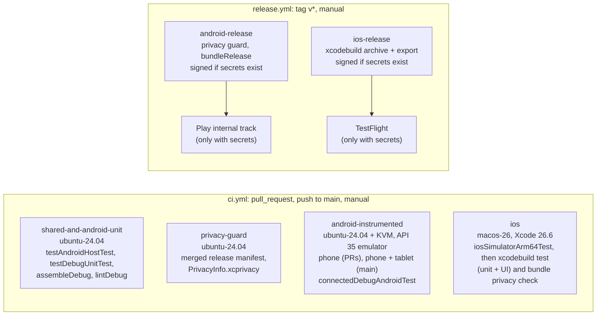

# CI / CD

GitHub Actions pipelines for Smart Mirror. Every workflow step calls a script in `scripts/ci/`, so you can run the same step locally.

## 1. Pipeline



The CI jobs run in parallel and none depends on another. A new push to the same PR or branch cancels the run in progress (`concurrency` with `cancel-in-progress`). Release runs are never cancelled.

| Workflow | Job | Trigger | Runner | Script | Artifacts |
|---|---|---|---|---|---|
| `ci.yml` | `shared-and-android-unit` | PR, push to `main`, manual | ubuntu-24.04 | `scripts/ci/unit.sh` | `unit-reports` (test and lint reports), `app-debug-apk` |
| `ci.yml` | `privacy-guard` | same | ubuntu-24.04 | `scripts/ci/privacy-guard.sh` | `merged-release-manifest` |
| `ci.yml` | `android-instrumented (phone)` | same | ubuntu-24.04 + KVM | `scripts/ci/android-connected.sh` | `android-instrumented-reports-phone` |
| `ci.yml` | `android-instrumented (tablet)` | push to `main`, manual | ubuntu-24.04 + KVM | same | `android-instrumented-reports-tablet` |
| `ci.yml` | `ios` | PR, push to `main`, manual | macos-26 | `scripts/ci/ios-test.sh` | `ios-test-results` (`.xcresult`, log) |
| `release.yml` | `android-release` | tag `v*`, manual | ubuntu-24.04 | `scripts/ci/android-release.sh` | `android-release-aab` (AAB + R8 mapping) |
| `release.yml` | `ios-release` | tag `v*`, manual | macos-26 | `scripts/ci/ios-release.sh` | `ios-release` (IPA, exportOptions.plist, dSYMs) |

Caching:
* Gradle: `gradle/actions/setup-gradle`. Only `main` writes the cache; other branches read it.
* Kotlin/Native: `~/.konan`, keyed on `gradle/libs.versions.toml`.
* AVD snapshot: `~/.android/avd`, keyed on API level, target, arch and device profile.

The app has no SPM dependencies, so there is no SPM cache. DerivedData is not cached because the Kotlin framework build phase makes it stale on every change.

Pinned toolchain:
* JDK 21 (Zulu, which matches `gradle-daemon-jvm.properties`)
* Android emulator API 35 `google_apis` x86_64, which is published for hosted runners. The app compiles against SDK 37.
* Xcode 26.6 on `macos-26`. The runner image also has 26.0.1 to 26.5.

The iOS simulator is resolved at runtime (`scripts/ci/resolve-simulator.sh`). The script prefers `$SIM_NAME`, then iPhone 17 Pro, then iPhone 16 Pro, then any iPhone on the newest runtime. A runner image update therefore does not break the job.

## 2. Release: signing and uploads

* **Android.** `androidApp/build.gradle.kts` creates a `release` signingConfig only when `ANDROID_KEYSTORE_PATH`, `ANDROID_KEYSTORE_PASSWORD`, `ANDROID_KEY_ALIAS` and `ANDROID_KEY_PASSWORD` are all set and the keystore file exists. Otherwise the release build is unsigned, and local `bundleRelease` / `assembleRelease` work as before. `android-release.sh` decodes `ANDROID_KEYSTORE_BASE64` to a temp file and deletes it afterwards. CI sets `versionCode` to 1000 + run number and sets `versionName` from the tag.
* **iOS.** `ios-release.sh` creates a temporary keychain, imports the distribution certificate, installs the profile, and archives with manual signing. It then exports with a generated `exportOptions.plist` (`app-store-connect`, manual signing, the profile mapped to the bundle ID) and removes the keychain and profile on exit. Without secrets it creates an unsigned archive as a compile check.
* **Uploads.** Play internal (as a draft) uses `r0adkll/upload-google-play`. TestFlight uses `xcrun altool` with an App Store Connect API key. An upload runs only when all of these are true:
  * the run is for a tag, or it is manual with `upload: true`;
  * the build was signed;
  * the upload secret exists.

  If a secret is missing, the step is skipped and the job summary says why. The workflow never fails because of a missing secret.

### Required secrets

These are repository secrets (Settings > Secrets and variables > Actions). CI (`ci.yml`) needs none.

| Secret | Used by | Content |
|---|---|---|
| `ANDROID_KEYSTORE_BASE64` | android-release | `base64 -i upload.jks` (the upload key, with Play App Signing) |
| `ANDROID_KEYSTORE_PASSWORD` | android-release | Keystore password |
| `ANDROID_KEY_ALIAS` | android-release | Key alias |
| `ANDROID_KEY_PASSWORD` | android-release | Key password |
| `PLAY_SERVICE_ACCOUNT_JSON` | android-release (upload) | Service-account JSON with release access to `com.smart.mirror.app` |
| `APPLE_TEAM_ID` | ios-release | 10-character Team ID |
| `IOS_BUNDLE_ID` | ios-release (optional) | App Store bundle ID. Defaults to the one in the profile. The project default is `com.smart.mirror.app.Smartmirrorapp$(TEAM_ID)` |
| `IOS_DIST_CERT_P12_BASE64` | ios-release | `base64 -i dist.p12` (Apple Distribution certificate and key) |
| `IOS_DIST_CERT_PASSWORD` | ios-release | .p12 password |
| `IOS_PROVISIONING_PROFILE_BASE64` | ios-release | `base64 -i AppStore.mobileprovision` |
| `APP_STORE_CONNECT_API_KEY_ID` | ios-release (upload) | API key ID |
| `APP_STORE_CONNECT_API_ISSUER_ID` | ios-release (upload) | Issuer ID |
| `APP_STORE_CONNECT_API_KEY_P8_BASE64` | ios-release (upload) | `base64 -i AuthKey_XXXX.p8` |

Protect tags matching `v*` and use an environment with required reviewers before you add store secrets.

## 3. Running the CI steps locally

Set up your environment first:
* Point `JAVA_HOME` at a JDK 17+. The scripts fall back to Android Studio's JBR.
* For Android, set `ANDROID_HOME`. The default is `~/Library/Android/sdk`.

Every long step runs under a timeout (`with_timeout` in `lib.sh`, based on perl `alarm`, because macOS has no `timeout` command).

```sh
scripts/ci/unit.sh                                   # = shared-and-android-unit
scripts/ci/privacy-guard.sh                          # = privacy-guard (add a path to an .app to check a bundle)
scripts/ci/android-connected.sh                      # = android-instrumented, on the one online device
scripts/ci/android-connected.sh --avd Medium_Phone   # cold-boots the AVD headless, tests, shuts it down
RUNS=3 scripts/ci/android-connected.sh --avd Medium_Phone   # flakiness check: 3 consecutive runs
scripts/ci/ios-test.sh                               # = ios (SIM_NAME="iPad Pro 11-inch (M5)" for iPad)
scripts/ci/android-release.sh                        # unsigned AAB unless the signing env vars are set
scripts/ci/ios-release.sh                            # unsigned archive unless the signing env vars are set
```

Lint the workflows with `actionlint` (`brew install actionlint`).

Tips for local runs on a small machine:
* Run one emulator or simulator at a time.
* Stop Gradle daemons and Android Studio before connected runs (see QA_REPORT section 2).
* Shut devices down afterwards: `adb emu kill`, `xcrun simctl shutdown all`.

## 4. Flaky-test policy

1. **Tests must be hermetic.** The instrumented suite uses the **Android Test Orchestrator** with `clearPackageData=true`, so each test runs in its own process on wiped app data.
   * The E2E tests also apply `ResetAppSettingsRule` (`androidApp/src/androidTest/.../E2eTestSupport.kt`). It resets the persisted settings and the app-scoped in-memory repository to `MirrorSettings.DEFAULT` before the Activity launches and again afterwards.
   * The rule also protects runs without the orchestrator, such as a single test from the IDE with the option overridden.
2. **Wait on state, not time.**
   * Use `waitUntil { <observable condition> }`, for example camera `RUNNING`, capture `IDLE`, or the window brightness value.
   * Don't use `Thread.sleep` or rely on `waitForIdle()` for effects outside Compose. `waitForIdle()` does not wait for ViewModel port side effects.
   * Timeouts live in `E2eTimeouts` and are sized for a cold, software-GPU CI emulator.
3. **No automatic retries.**
   * CI does not retry tests: no Gradle test-retry plugin, no `am instrument` rerun loop, no `retry` wrapper around the emulator step.
   * If a run fails and you suspect flakiness, re-run the failed job **once** from the Actions UI. If it then passes, open an issue labelled `flaky` with both reports, the test name and the suspected cause.
   * If a flaky test is not fixed within 5 working days, quarantine it with `@Ignore("FLAKY-#<issue>")` and mention it in QA_REPORT. The suite must not stay red, and it must not silently retry.
   * Retries may be added only as a documented last resort. That means a time-boxed, per-test `@FlakyTest` filter with a linked issue, never a blanket retry.
4. **Known-bug tests** annotated `@Ignore("QA-BUG-xx")` (for example `supportAddressIsNotAPlaceholder`) are expected skips, not flakes.

### Root cause of the earlier E2E flakiness (fixed)

Three E2E tests failed on the first run on a freshly booted emulator and passed on later runs:
* `MainActivityEndToEndTest.launch_showsLiveMirror_tapShowsControls_captureSaves`
* `QaEndToEndTest.frozenCapture_savedPhotoMatchesScreen_inMirrorAndTrueView`
* `QaEndToEndTest.autoMaxBrightnessOff_leavesUserBrightnessAlone`

**Root cause.** The tests assumed default settings but never reset them.
* The app persists settings in SharedPreferences. `installDebug -r` keeps that data, and exploratory or `am instrument` sessions had left the emulator's app in true view with the ring light on.
* The connected run therefore started from those settings:
  * `previewMirrored` was false.
  * The "Showing mirror view" toggle did not exist.
  * Brightness stayed at 1.0, because the ring light also forces maximum brightness.
* AGP uninstalls the app after a connected run, which wiped the data. That is why the next runs passed.
* The failure was reproduced deterministically by seeding those preferences before a run.
* A second, latent leak: the settings repository is app-scoped and lives for the whole instrumentation process. `frozenCapture` switches to true view and never restores it, so any mirror-dependent test that ran after it in the same process would inherit true view.

**Fix.**
* Test code: `ResetAppSettingsRule`, state-based waits, and precondition assertions.
* Build config: the orchestrator with `clearPackageData`.
* No production code changed.

## 5. Branch protection (recommended for `main`)

* Require a pull request before merging, with at least 1 approval. Dismiss stale approvals on new commits.
* Require these status checks to pass, and require branches to be up to date before merging:
  * `Shared + Android unit, lint, debug APK`
  * `Privacy guard`
  * `Android instrumented (phone)`
  * `iOS (shared K/N tests + XCTest + XCUITest)`
* Don't make `Android instrumented (tablet)` a required check. It runs only on `main`, so it can never report on a PR.
* Require linear history. Block force pushes and branch deletion. Include administrators.
* Protect tags matching `v*` so that only maintainers can create them, because tags trigger release uploads. Put the store secrets in a `release` environment with required reviewers.
* Enable Dependabot security updates. Dependabot version PRs (`.github/dependabot.yml`: weekly updates for Gradle and GitHub Actions) go through the same required checks.
